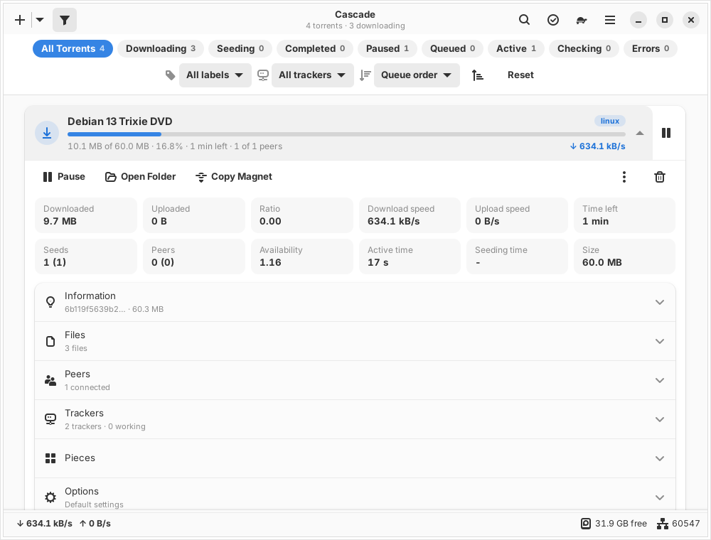
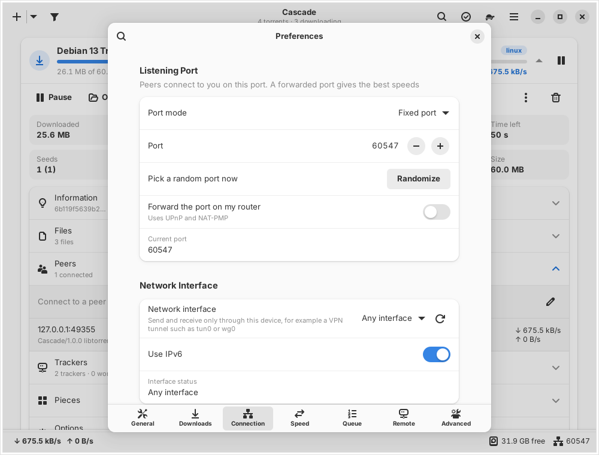
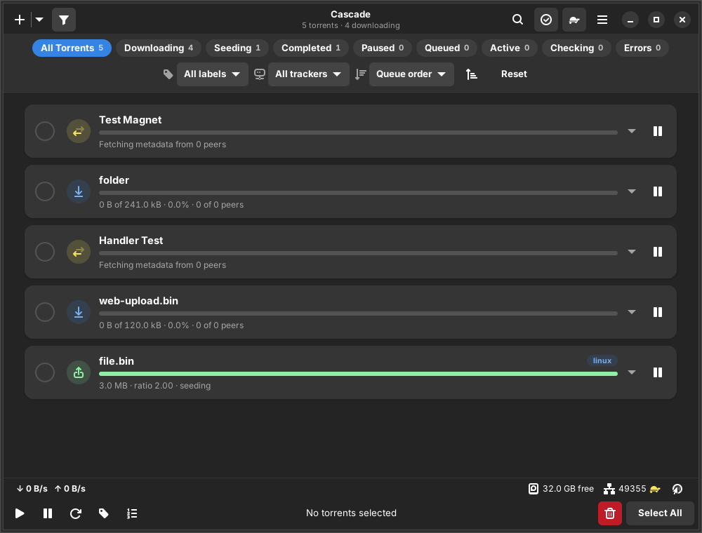
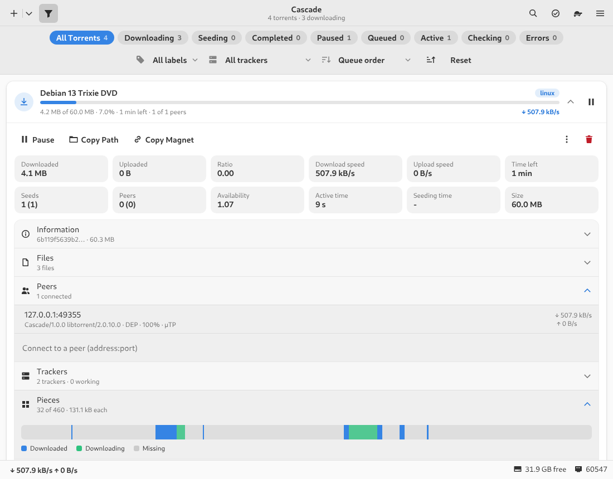
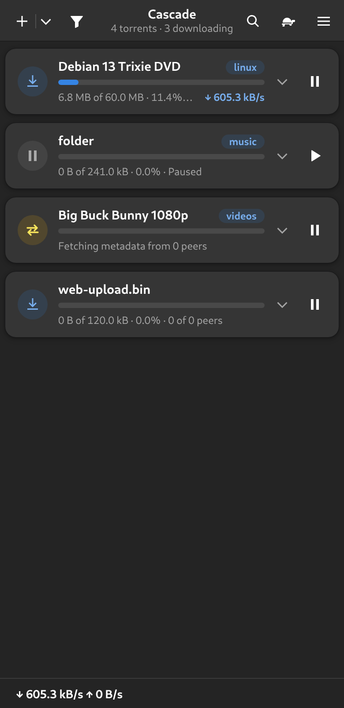

<h1 align="center">Cascade</h1>

<p align="center">
  
</p>

<p align="center">
  <a href="https://github.com/Smiley-McSmiles/Cascade-GTK/releases"></a>
  <a href="LICENSE"></a>
  <a href="https://python.org"></a>
  <a href="https://gtk.org"></a>
  <a href="https://libtorrent.org"></a>
</p>

<p align="center">
  An elegant <b>GTK4 / libadwaita</b> BitTorrent client with the power of Deluge or qBittorrent,<br>
  a complete <b>command line</b>, and a one-click <b>web interface</b> that looks just like the app.<br>
  All three share the same torrents and the same settings.
</p>

## 👥 Developers & Attribution

Cascade is developed and maintained by:
- **WOOSAH** (Lead Architect & Maintainer)
- **Claude** (Engineer)

Project GitHub: [https://github.com/Smiley-McSmiles/Cascade-GTK](https://github.com/Smiley-McSmiles/Cascade-GTK)

## Screenshots

| GTK app | Preferences |
|---|---|
|  |  |
| **Dark style, selection mode** | **Web interface** |
|  |  |

<p align="center"></p>

## Features

**No pop-up windows.** Click a torrent and its card rolls open right in the list: transfer tiles (downloaded,
uploaded, ratio, speeds, time left, seeds, peers, availability, active and seeding time) and rows that roll down
when clicked - **Information** (info hashes v1/v2, pieces, save path, dates, comment), **Files** (with per-file
priorities), **Peers** (client, flags, progress, speeds; connect to a peer by hand), **Trackers** (status, seeds,
next announce; add and remove), **Pieces** (a map of what you have) and **Options** (per-torrent limits,
sequential download, first/last pieces, super seeding, seeding limit, label).

**Filter button instead of a sidebar.** The funnel button rolls down a bar of filter chips with live counts (All,
Downloading, Seeding, Completed, Paused, Queued, Active, Checking, Errors) plus label, tracker and sort choices.
Search, selection mode for bulk actions, a status bar with speeds, free space, DHT nodes, port reachability and the
bound interface, and a statistics popover with a speed graph.

**Adding torrents.** Magnet links clicked in your browser, `.torrent` files from the file manager, drag and drop,
pasting (Ctrl+Shift+V), URLs of `.torrent` files, a watch folder (`.torrent` and `.magnet` files) and the command
line. An add sheet lets you pick the folder, label, files and options first (it can be turned off).

**Network and VPN.**
- Bind every connection to one network device (`tun0`, `wg0`, ...) with a **kill switch** that pauses all transfers
  the moment the device goes down or loses its address - nothing leaks over your normal connection.
- **Port modes:** a fixed port, a **new random port at every start** (within a range you choose), **VPN port
  forwarding over NAT-PMP** (ProtonVPN and others: renewed every 45 seconds, Cascade listens on the port the VPN
  hands out) or a **port read from a file** (e.g. gluetun's `/tmp/gluetun/forwarded_port`), plus UPnP/NAT-PMP on
  your router. "Randomize" picks a new port with one click.
- DHT, PeX, local peer discovery, µTP, encryption (prefer/require/allow/disable), anonymous mode, SOCKS4/5, HTTP
  and I2P proxies, IP blocklists (P2P, DAT, CIDR; plain, gzip or zip; from a URL or a file, auto-updated).

**Speed.** Global limits, a **slow mode** (the turtle button) with its own limits, and a **weekly schedule**: paint
the hours of each day as full speed, slow mode or paused. Option to apply the limits to the LAN too.

**Queue and seeding.** Active download/seed/torrent limits, slow torrents don't count, force start, queue moves,
stop seeding at a ratio, after a time or when idle (pause, remove, or remove with the data), per-torrent overrides.

**Downloads.** Keep unfinished downloads in another folder (moved when complete), `.part` extensions on unfinished
files, pre-allocation, copies of added `.torrent` files, labels with their own folders, commands to run when a
torrent is added or finishes, desktop notifications, and torrent creation (v1, v2 or hybrid; private; web seeds).

**One-click web interface.** Turn on "Web interface" in Preferences → Remote (or `cascade webui on`): a password is
created and shown once. The page is a copy of the GTK app (same cards, filter bar, rolling rows, preferences built
from the same schema, schedule painter), works on phones, follows the light/dark style, installs as a web app, and
can register itself as your browser's magnet-link handler. Optional HTTPS with your own certificate.

**Command line.** Everything the app can do: `cascade add/list/watch/info/files/peers/trackers/pause/resume/start/
recheck/remove/move/queue/limit/option/label/slow/schedule/config/get/set/port/interfaces/webui/create/log`, with
`--json` output and shell completions for bash, zsh and fish. It can also drive a remote Cascade through its web
interface: `cascade --url http://nas:8150 --password ... list`.

## Architecture

```
 cascade-gtk (GTK4/libadwaita) ─┐
 cascade (CLI)                ──┼── Unix socket (JSON-RPC) ──►  cascaded (one per user)
 browser ── HTTP(S) /api/rpc  ──┘    the same methods            ├─ libtorrent session, resume data
                                                                 ├─ kill switch, port modes, NAT-PMP
                                                                 ├─ schedule, queue, seeding limits
                                                                 ├─ watch folder, blocklist, hooks
                                                                 └─ settings.json (validated by schema.py)
```

The service runs as **you** (no root) and the GTK app starts it on demand. With "Keep running in the background"
on (the default) transfers, the web interface and the CLI keep working after the window closes; "Quit and Stop
Transfers" in the menu stops everything. Every preference is declared once in `cascade/schema.py`; the GTK
preferences, the web preferences and `cascade config` are generated from it.

## Installation

### Packages

Download a package from the [releases](https://github.com/Smiley-McSmiles/Cascade-GTK/releases) page, or build
them yourself with `./package.sh` (see below):

| Distribution | Command |
|---|---|
| Debian, Ubuntu, Mint | `sudo apt install ./cascade_1.0.0_all.deb` |
| Fedora, RHEL, openSUSE | `sudo dnf install ./cascade-1.0.0-1.noarch.rpm` |
| Arch, Manjaro | `sudo pacman -U cascade-1.0.0-1-any.pkg.tar.xz` |
| Void | `sudo xbps-install -R dist cascade` |
| Anything else | `tar xf cascade-1.0.0.tar.gz && cd cascade-1.0.0 && sudo ./install.sh --install-deps` |

### From source

```sh
git clone https://github.com/Smiley-McSmiles/Cascade-GTK.git && cd Cascade-GTK
sudo ./install.sh --install-deps      # system-wide (/usr/local), installing the dependencies first
./install.sh --prefix ~/.local         # or just for you, without root
./install.sh --check                   # only check what is missing
```

Dependencies: Python 3.9+, the Python bindings of **libtorrent 2.0** and, for the app, PyGObject, **GTK 4** and
**libadwaita 1.5+**. The command line, the service and the web interface need only Python and libtorrent.

| Package manager | Dependencies |
|---|---|
| apt | `python3-libtorrent python3-gi gir1.2-gtk-4.0 gir1.2-adw-1` |
| dnf (Fedora) | `rb_libtorrent-python3 python3-gobject gtk4 libadwaita` |
| pacman | `libtorrent-rasterbar python-gobject gtk4 libadwaita` |
| xbps | `python3-libtorrent-rasterbar python3-gobject gtk4 libadwaita` |
| apk | `py3-libtorrent-rasterbar py3-gobject3 gtk4.0 libadwaita` |
| zypper | `python3-libtorrent-rasterbar python3-gobject typelib-1_0-Gtk-4_0 typelib-1_0-Adw-1` |

If your distribution has no libtorrent bindings, `pip install --user libtorrent` works too.

Run it: **Cascade** in your application menu, `cascade-gtk`, or `cascade` in a terminal.

## Magnet links from your browser

Installing registers Cascade for `magnet:` links and `.torrent` files. The first time the app starts it offers to
become the default handler; you can also do it any time in Preferences → General → "Open magnet links with
Cascade". Clicking a magnet link in Firefox, Chrome or any other browser then opens the add sheet in the running
window. In the web interface, main menu → "Open Magnet Links Here" registers the page itself as the handler
(browsers allow that over HTTPS or on localhost).

## Using a VPN

```sh
cascade interfaces                       # see your devices; VPN ones are marked
cascade set net.interface wg0            # bind to the tunnel (the kill switch is on by default)
cascade set net.port_mode natpmp         # ProtonVPN-style port forwarding (gateway 10.2.0.1 by default)
cascade set net.natpmp_gateway 10.2.0.1
cascade status                           # Port: 51820 via 10.2.0.1 · Interface: wg0 is up (10.2.0.2)
```

When the tunnel drops, every transfer pauses and the window shows a banner; when it comes back, Cascade rebinds and
resumes on its own. With gluetun or a port-forwarding script that writes the port to a file, use
`cascade set net.port_mode file net.port_file /tmp/gluetun/forwarded_port`.

## Command line

```sh
cascade add 'magnet:?xt=urn:btih:…' -l linux           # or file.torrent, or https://…/file.torrent
cascade add big.torrent -p ~/Videos --sequential --paused
cascade list -f downloading                             # filters: downloading seeding completed paused …
cascade watch                                           # live view
cascade info 1 && cascade files 1 --set 3=skip 1-2=high
cascade pause all ; cascade resume 2 ; cascade start 3  # start = force start (skips the queue)
cascade remove 4 --data
cascade slow on                                         # the turtle
cascade schedule set mon-fri 9-17 slow ; cascade schedule set weekend 1-7 pause
cascade set speed.download 5000 queue.max_downloads 5
cascade config connection                               # every setting of a page, with its key
cascade port random
cascade webui on                                        # prints the address and the new password
cascade create ~/Music/album -t udp://tracker.example:1337 --private --seed
cascade --json list | jq '.[] | .name'
```

Torrents are named by their number in `cascade list`, a unique id prefix, or a unique part of their name.
`man cascade` has the complete reference.

## Running headless (servers, NAS, seedboxes)

Preferences → General → **Start when the computer starts** (or `cascade boot enable`) makes Cascade run at boot,
before anyone logs in, on every supported init system:

| Init system | What it sets up | Root? |
|---|---|---|
| systemd | a user unit + `loginctl enable-linger` for your account | no |
| runit (Void, Artix) | `/etc/sv/cascaded-USER`, linked into `/var/service` | yes |
| OpenRC (Alpine, Gentoo, Artix) | `/etc/init.d/cascaded.USER` in the default runlevel | yes |
| FreeBSD | `/usr/local/etc/rc.d/cascaded` + `cascaded_enable`/`cascaded_user` in rc.conf | yes |
| OpenBSD | `/etc/rc.d/cascaded` enabled with `rcctl`, running as you | yes |

The service always runs as you. Where root is needed the app asks for your password (polkit), and the command line
uses sudo or doas. `cascade boot status` shows what is set up; `cascade boot disable` undoes it.

By hand:

```sh
systemctl --user enable --now cascaded           # run in the background for your account
sudo loginctl enable-linger $USER                # ... even when you are not logged in
sudo systemctl enable --now cascaded@alice       # or: as user alice at boot (system unit)
cascade webui on                                 # then use it from any browser
```

OpenRC: `ln -s cascaded /etc/init.d/cascaded.alice && rc-update add cascaded.alice`. runit: copy
`/usr/share/cascade/runit` to `/etc/sv/cascaded-alice` and link it into `/var/service`. Without any init system,
Preferences → General → "Start on login" adds a desktop autostart entry for the service.

## Files

| Path | What |
|---|---|
| `~/.config/cascade/settings.json` | settings (only the service writes it) |
| `~/.local/share/cascade/` | torrents (resume data), labels, statistics, blocklist cache |
| `~/.local/state/cascade/cascade.log` | log (`cascade log`) |
| `$XDG_RUNTIME_DIR/cascade/cascade.sock` | the control socket (only your user can open it) |

`CASCADE_HOME=/some/dir` keeps all of them under one directory (portable setups, testing).

## Development

```sh
python3 -m cascade gui                          # run from the source tree
python3 -m cascade daemon                       # the service in the foreground, logging to the terminal
python3 -m unittest tests.test_cascade -v       # tests; real daemons transfer a real torrent over 127.0.0.1
xvfb-run -a python3 -m unittest tests.test_cascade   # ... including the GTK smoke test
python3 tools/gen_completions.py                # regenerate shell completions after changing the CLI
python3 tools/check_version.py                  # the version must match everywhere
```

### Packaging

`package.sh` has the same options as VPNMan's:

```sh
./package.sh                 # everything this machine can build: tarball, deb, rpm, Arch, Void + recipes
./package.sh --deb --arch    # selected packages (plain names work too: ./package.sh deb arch)
./package.sh --container --rpm   # build the rpm inside a Fedora container (podman/docker)
./package.sh --recipes       # only the spec, PKGBUILD, Void template, APKBUILD and OpenBSD port
./package.sh --clean
```

The `.deb` and Arch packages are written by small Python helpers in `packaging/`, so they build on any
distribution; `dist/SHA256SUMS` lists every artifact. Pushing a tag such as `v1.0.1` builds all packages and
publishes a GitHub release with notes taken from the AppStream metainfo.

## License

MIT - see [LICENSE](LICENSE).
